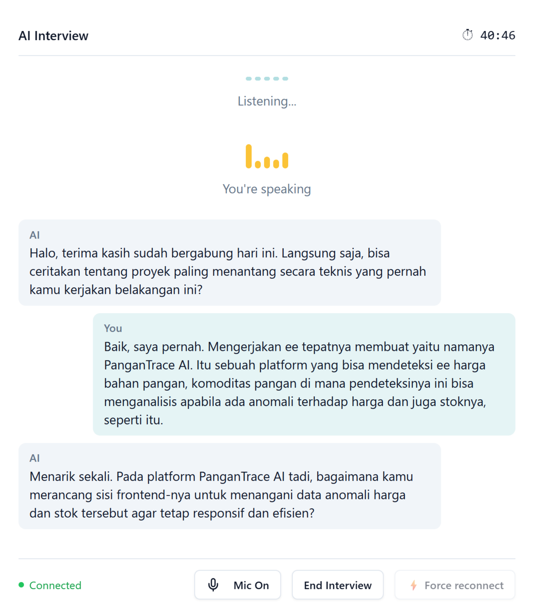
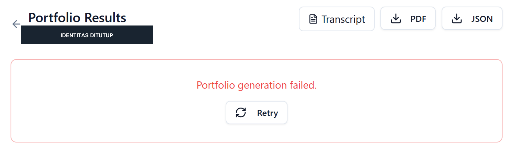
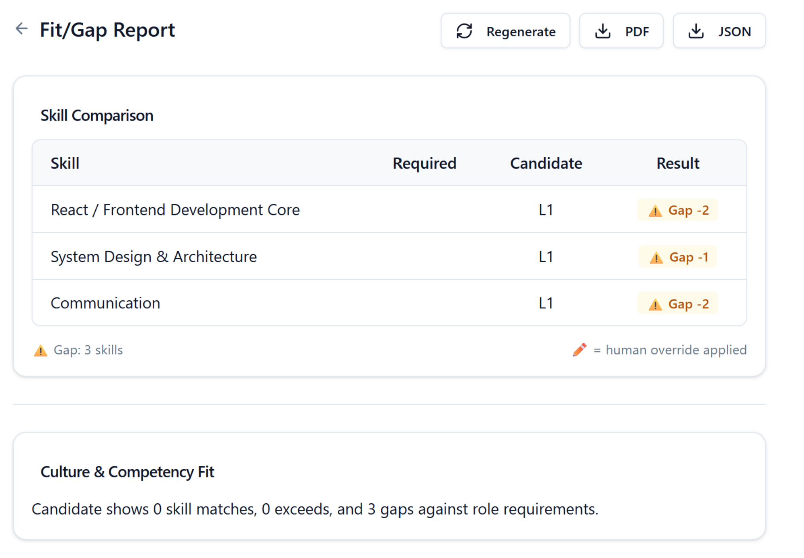
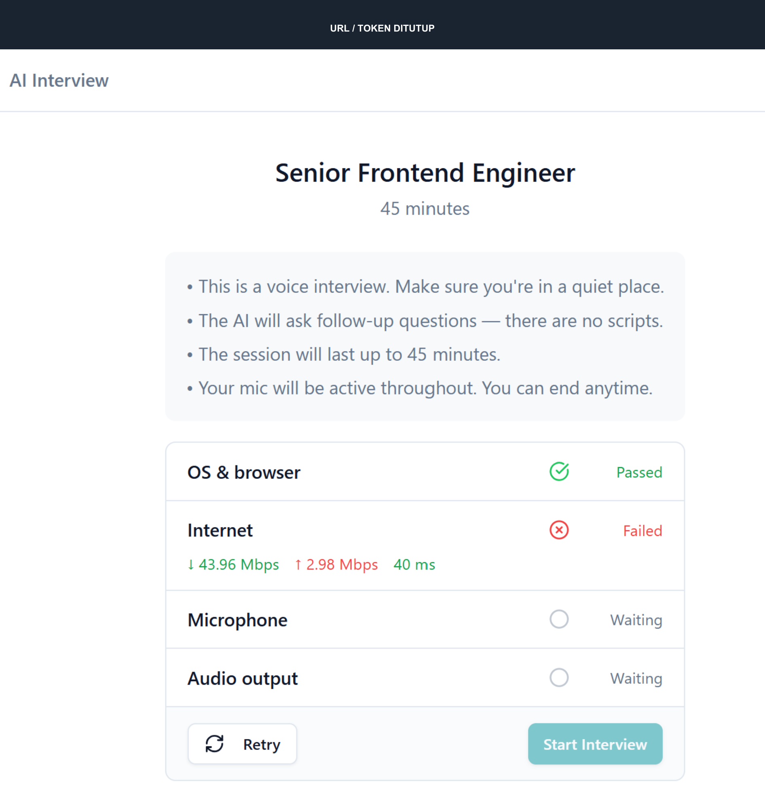
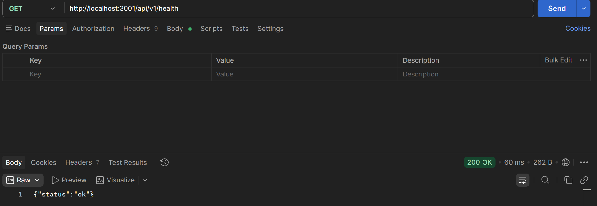
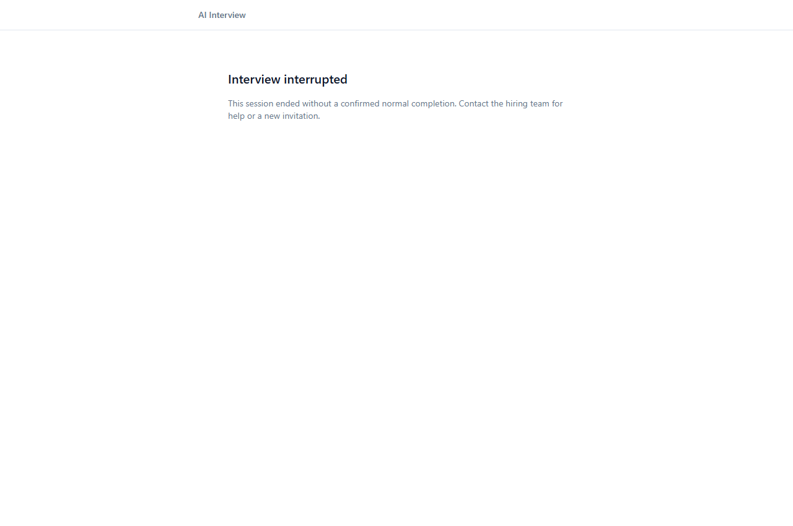
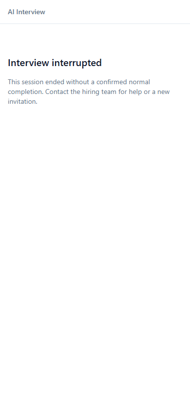

# AI Interview Platform

## Laporan Studi Kasus Fullstack Product Engineer

**Versi review - 28 Oktober 2026**  
**Fokus:** memperbaiki pengumpulan evidence melalui audio, resume sesi, dan kejujuran status akhir kandidat.

Repository asal: [rakamindev/ai-interview-platform](https://github.com/rakamindev/ai-interview-platform)  
Fork: [loma09/ai-interview-platform](https://github.com/loma09/ai-interview-platform)

**Status pengumpulan:** [PR #214](https://github.com/rakamindev/ai-interview-platform/pull/214) sudah terbuka ke repository asal; branch aplikasi dan history seeded fault telah dipublikasikan. Lima screenshot live yang sudah disanitasi disertakan sebagai E10. Video demo 3-5 menit belum tersedia; screenshot recovery dan portfolio sukses belum tersedia. PDF ini tetap versi review hingga paket pengumpulan lengkap.

## Ringkasan

Produk ini membantu assessor mengumpulkan dan meninjau bukti kemampuan kandidat melalui wawancara suara adaptif. Keberhasilan produknya tidak cukup diukur dari percakapan yang selesai atau portfolio yang berhasil dibuat. Jawaban harus masuk dengan benar, kegagalan teknis harus terlihat, dan penilaian harus dapat ditelusuri ke evidence.

Eksplorasi menemukan input kandidat yang tidak muncul, AI diam, dan reload yang berujung pesan sukses meskipun sesi berakhir karena error. Saya memilih memperbaiki jalur audio pada frontend dan backend, kemudian memperluas scope ke resume dan status akhir setelah pengujian manual membuktikan kelemahannya. Pemulihan integrasi portfolio dilakukan agar alur bisa diperiksa sampai hasil, fit/gap, dan ekspor.

Verifikasi terakhir yang diarsipkan menghasilkan **26 tes frontend lulus dan 18 contoh backend tanpa kegagalan**. Tes browser sintetis dan build juga lulus. Pengguna berhasil melakukan percakapan beberapa giliran, memperoleh portfolio/fit-gap/ekspor pada sesi 18, dan akhirnya melanjutkan sesi 23 setelah sempat macet. Pengujian itu belum membuktikan setiap reload pulih otomatis, ketahanan 45 menit, atau akurasi penilaian.

**Keputusan produk:** perubahan layak dijelaskan sebagai perbaikan fullstack yang terukur, dengan keterbatasan terbuka. Bukti yang tersedia belum cukup untuk merekomendasikan platform ini sebagai dasar keputusan hiring tanpa review manusia dan pekerjaan lanjutan.

## Step 1 - Setup dan eksplorasi

### Menjalankan baseline

Repository memuat `api/` untuk Rails/PostgreSQL/Sidekiq dan `web/` untuk React/TypeScript/Vite. Pengerjaan berada pada branch `loma/project-setup`; perubahan produk tersedia pada [PR #214](https://github.com/rakamindev/ai-interview-platform/pull/214).

| Komponen | Lingkungan yang digunakan |
| --- | --- |
| Frontend | Vite di Windows; localhost:5173 |
| API | Ruby 3.3.2/Rails di Docker Linux; localhost:3001 |
| Worker | Sidekiq pada container terpisah |
| Database | PostgreSQL 16; port host 5433 |
| Broker | Redis; port host 6380 |

Rails native Windows sempat berjalan untuk REST setelah penyesuaian timezone dan worker Puma. Audio kemudian terblokir karena EventMachine instalasi lokal tidak menyediakan TLS. Backend dan worker dipindahkan ke Linux container dengan database existing dipertahankan. Ini pemulihan lingkungan, bukan peningkatan kemampuan kandidat atau bukti masalah production yang sama.

Konfigurasi frontend diarahkan ke API port 3001. Origin undangan diarahkan ke frontend karena route `/interview/:token` dimiliki React. File secret dikelola lokal oleh pengguna, tidak dibaca untuk penyusunan laporan dan tidak dimasukkan ke build context/artefak baru. Detail reproduksi setup ada di `assessment/setup.md`.

### Workflow yang diperiksa

Health API diuji melalui Postman, dilanjutkan login assessor, membuat assessment, mengundang kandidat, hardware check, percakapan, akhir sesi, portfolio, vacancy, fit/gap, serta unduh PDF/JSON. Pengujian memakai assessment frontend engineering dan vacancy dengan target React L3, Communication L3, serta System Design L2.

Hasil awal tidak diperlakukan sebagai bukti semua alur sehat. Sebagai contoh, localhost ping/upload membuat hardware check lulus, tetapi bukan pengukuran kualitas internet ke provider AI. Health API juga tidak membuktikan kesiapan model atau worker.

## Step 2 - Konteks produk, industri, dan kandidat

### Mengapa bukti kemampuan lebih penting daripada jumlah wawancara

Pasker ID mencatat 3.031.614 lamaran melalui Karirhub pada Januari-September 2026. Angka tersebut merupakan volume lamaran dalam layanan itu, bukan jumlah kandidat unik atau ukuran pasar platform ini. Ini memberi konteks bahwa alur seleksi digital berlangsung pada skala yang berarti, tanpa membuktikan kebutuhan pembeli tertentu. [1]

Karirhub sudah menyediakan job matching dan talent search tanpa biaya menurut dokumentasi Kemnaker. Karena fungsi discovery dan pencocokan dasar sudah tersedia, saya menempatkan nilai pembeda produk pada pengumpulan evidence adaptif dan review yang dapat ditelusuri. Pernyataan pembeda ini adalah hipotesis produk, bukan hasil riset kompetitor menyeluruh. [2]

ILO mendefinisikan skills mismatch sebagai perbedaan antara kemampuan yang dibutuhkan pemberi kerja dan yang dimiliki individu. Dalam kasus ini, konsekuensinya: label pekerjaan atau pertanyaan yang sudah diajukan tidak cukup membuktikan kemampuan. Sebuah rating perlu contoh tindakan, penalaran, dan hasil yang relevan. Ini penerapan konsep ILO pada desain produk, bukan ukuran mismatch dari sesi uji. [3]

### Pekerjaan pengguna dan hasil yang seharusnya didukung

| Pihak | Pekerjaan yang perlu dibantu | Konsekuensi desain |
| --- | --- | --- |
| Recruiter | Mengatur undangan dan mengetahui siapa yang perlu ditindaklanjuti | Bedakan belum mulai, terganggu, selesai, dan hasil belum siap |
| Assessor | Meninjau jawaban dan membandingkan dengan anchor skill | Tampilkan evidence, confidence, dan keterbatasan; sediakan review/override |
| Hiring manager | Menentukan area yang masih perlu diuji | Pisahkan kemampuan yang terukur dari skill belum dinilai |
| Kandidat | Menyampaikan kemampuan dan memahami gangguan yang terjadi | Input tidak dipotong, sesi dapat dipulihkan, error tidak disebut sukses |

Alur kerja di atas merupakan hipotesis dari PRD dan eksplorasi, bukan kutipan wawancara recruiter. Kandidat tidak mengendalikan desain sistem yang menilainya, sehingga kehilangan input atau salah transkripsi tidak boleh diam-diam menjadi kesimpulan kemampuan rendah. Validasi kebutuhan melalui riset pengguna tetap pekerjaan lanjutan.

### Implikasi UU PDP

Data yang terhubung ke kandidat diperlakukan sebagai data pribadi dalam desain ini. Pemetaan berikut merujuk UU 27/2022 yang tercatat berlaku; ini bukan audit atau pernyataan kepatuhan. [4][5]

| Acuan | Implikasi produk yang diusulkan |
| --- | --- |
| Pasal 20-22 | Tetapkan dasar pemrosesan; bila memakai persetujuan, jelaskan tujuan, data, retensi, dan hak sebelum rekaman |
| Pasal 10 dan 34 | Sediakan review/keberatan; evaluasi dampak pemrosesan berisiko tinggi, termasuk scoring sistematis |
| Pasal 6-8 dan 29 | Rancang koreksi, akses salinan, akurasi, serta penghapusan sesuai ketentuan |
| Pasal 35-39 | Batasi akses dan lindungi kerahasiaan; token pada log F08 belum ditutup |
| Pasal 56 | Verifikasi syarat transfer dan pengaturan provider sebelum pemrosesan lintas negara |

Usulan engineering: petakan aliran audio/transkrip ke vendor, pisahkan keputusan assessor dari keluaran model, tentukan owner retensi, dan gunakan data fiktif untuk demo. Review legal serta kontrak vendor belum dilakukan. Rekaman suara tidak otomatis diklaim sebagai biometrik tanpa menilai cara pemrosesannya.

## Step 3 - Masalah, prioritas, dan gap

### Masalah utama yang dipilih

Percakapan adalah jalur pengumpulan bukti. Pada baseline, context audio dapat belum aktif saat sesi tersambung, suara pelan dapat diganti nol oleh processor, dan pergantian giliran tidak selalu membuka mikrofon. Pada resume, handle yang ditolak terus dipakai ulang dan pekerjaan koneksi lama belum dilepas. Di sisi presentasi, beberapa kegagalan berubah menjadi Interview Complete.

Saya memisahkan bug implementasi, konfigurasi/integrasi, gap produk, dan observasi yang belum terkonfirmasi. P1 berarti alur utama atau interpretasi evaluasi terdampak serius; P2 mengganggu pemahaman/pemulihan dengan workaround. Tidak ada P0/P3 yang sengaja diisi tanpa bukti.

| ID | Dampak utama | Prioritas | Status saat laporan |
| --- | --- | --- | --- |
| F07 | Audio/turn macet menghambat pengumpulan bukti | P1 | Source/test diperbaiki; hasil live terbatas, gejala intermiten masih dicatat |
| F01 | Kegagalan teknis ditampilkan sebagai sukses | P1 | Kontrak outcome dan UI diperbaiki; verifikasi sintetis lulus |
| F04 | Hasil tidak tersedia karena endpoint/model/kuota | P1 saat terjadi | Sesi 18 pulih; sesi baru berikutnya kembali tertahan limit provider |
| F06 | Undangan membuka origin API yang salah | P1 saat terjadi | Konfigurasi lokal dipulihkan |
| F09/F11 | Evidence kosong menjadi L1, lalu dihitung sebagai gap | P1 | Terbuka; satu rantai masalah, bukan dua akar independen |
| F08 | Token invite terlihat pada log development | P2 terbatas | Terbuka; cakupan production belum diaudit |
| F02 | Retry hardware tertahan Checking | P2 | Direproduksi ulang; Allow + reload menjadi workaround |
| F03 | Status akhir sesi dan kesiapan portfolio kurang jelas | P2 | Terbuka pada workflow assessor |
| F05 | Internet check kurang menjelaskan batas dan metode | P2 | Terbuka; localhost bukan bukti internet baik |
| F10 | Target Required kosong pada tabel fit/gap web | P2 | Terbuka; API mengirim expected_level, UI membaca required_level |
| F12 | Complete masih membawa error percobaan lama di JSON | P2 | Terbuka; metadata error aktif/riwayat belum konsisten |

Observasi probing yang berpindah topik, confidence HIGH pada jawaban umum, dan token bahasa asing pada transkrip belum cukup untuk menyimpulkan semua penilaian salah. Coverage perlu dicocokkan dan ucapan asli perlu dibedakan dari artefak transkripsi. Rincian serta reproduksi berada di `assessment/findings.md`.

### Constraint signal untuk Technical Lead

Tiga risiko perlu disampaikan lebih awal: kompatibilitas TLS/runtime lokal, lifecycle/kuota provider yang berubah, dan kontrak penilaian yang belum membedakan belum dinilai dari level rendah. Ada pula debt pada lifecycle job/status dan diagnostik token. Menambah retry saja tidak menyelesaikan error konfigurasi, kuota nol, atau bukti kandidat yang tidak tersedia.

## Step 4 - Strategi dan acceptance criteria

### Opsi dan keputusan

| Opsi | Nilai yang diperoleh | Biaya dan kegagalan yang tersisa |
| --- | --- | --- |
| A. Konfigurasi dan restart saja | Cepat membuka hambatan lingkungan | Startup race, pemotongan PCM, callback lama, serta false success tetap ada |
| B. Koreksi capture/playback/lifecycle existing | Menangani perilaku yang direproduksi tanpa mengganti platform | Tetap bergantung pada perangkat/provider; butuh regression test dan live verification |
| C. Ganti transport/provider atau bangun ulang sesi | Dapat merancang kontrak baru lebih luas | Biaya migrasi, integrasi, dan permukaan regresi lebih besar dari bukti yang tersedia |

Opsi B diimplementasikan. Konfigurasi pada A dipakai untuk eksplorasi. C belum dibenarkan oleh kebutuhan slice dan waktu pengerjaan. Frontend tetap memakai hook serta design system existing; backend tetap menggunakan Rails, EventMachine dan client Gemini yang ada.

PCM16 mono 16 kHz dikirim utuh selama giliran kandidat, sekitar 32 KB/detik sebelum overhead. Biayanya lebih tinggi dibanding filter volume lokal, tetapi suara pelan dan timeline hening tidak dibuang. Indikator UI hanya menunjukkan energi suara. Pengiriman frame kontinu juga berarti timer berbasis berhentinya frame tidak selalu menutup giliran; gejala macet setelah resume tetap perlu dinyatakan sebagai batas, bukan ditutupi angka tes hijau.

Pada browser detach, koneksi lama dilepas agar tidak punya timer yang mengakhiri halaman baru. Bila handle ditolak secara spesifik, satu fallback membangun konteks dari maksimal 40 turn tersimpan. Ini tidak memulihkan audio in-flight. Record abandoned dapat tetap active; cleanup durable dan ownership multi-tab belum diselesaikan.

### Kriteria penerimaan dan bukti

| Perilaku yang diterima | Hasil saat ini |
| --- | --- |
| Start tidak membuka WebSocket sebelum capture/playback siap | Lulus otomatis |
| Suara pelan dan seluruh frame hening dipertahankan processor | Lulus pada processor asli dan harness |
| Mute menahan input; unmute meneruskan input; playback berurutan | Lulus otomatis dan Web Audio sintetis |
| Permission/worklet gagal tidak membuka sesi diam; stop/unmount melepas resource | Lulus otomatis; precheck Block/Allow + reload lulus manual |
| Model completion tanpa audio/generationComplete tetap mem-flush buffer dan membuka gate satu kali | Lulus spec backend |
| Koneksi detached tidak terus retry/end; handle expired punya fallback terbatas | Lulus spec lifecycle; live sesi 23 akhirnya berlanjut setelah intervensi |
| End error/load failure/retry exhausted tidak disebut sukses; manual end menunggu ack | Lulus UI/protokol sintetis |
| Resume tidak memberi batas waktu baru | Lulus kontrak sisa waktu dan batas server; stopwatch live belum dikonfirmasi terpisah |
| Portfolio, fit/gap, PDF dan JSON memuat hasil skenario sama | Lulus manual sesi 18; kualitas rating/metadata masih ada temuan |
| Tes menangkap fault disengaja dan kembali lulus setelah pemulihan | Lulus lokal dengan tiga commit |

Kriteria rinci AC01-AC14 dan batas V01-V07 ada di `assessment/scope-final.md`. Tabel ini merangkum status, bukan menambah bukti. Sebagian rationale/kriteria dirapikan setelah investigasi; laporan tidak mengklaim seluruh dokumen keputusan sudah ditulis sebelum perubahan pertama.

## Step 5 - Implementasi, pengujian, dan hasil

### Perubahan fullstack

| Area | Perubahan konkret |
| --- | --- |
| Capture dan playback React | Resume context dari gesture, active graph, startup cancellation, cleanup, serta callback playback yang dibatalkan saat stop |
| Processor PCM | Hapus filter RMS tetap yang menimpa input pelan dan memangkas hening |
| Halaman kandidat dan hook WS | Loading/load error/interrupted/connection lost/complete dipisahkan; intentional unmount tidak reconnect; End menunggu ack; retry milik halaman lama dibersihkan |
| Contract candidate_info | Tambah end_reason dan remaining_seconds dari waktu mulai asli |
| LiveClient/middleware | Completion/flush/gate, cleanup detach, bounded fallback expired handle, role-labelled history, serta checkpoint non-resumable |
| REST Gemini | Koreksi endpoint v1 ke v1beta untuk jalur model yang diuji |

Tidak ada migrasi database. Endpoint authorization dan tenant policy tidak dinyatakan telah diaudit hanya karena kontrak response ditambah. Source deployment lokal memakai copy file dan restart development; image baru dibangun, tetapi prosedur release immutable dan rollback terotomasi belum tersedia.

### Evidence otomatis yang diarsipkan

| Area | Bukti sebelum perbaikan | Hasil terbaru |
| --- | --- | --- |
| Frontend reload/outcome | 9 gagal, 15 lulus pada suite 24 tes | Suite berkembang menjadi 26 tes, seluruhnya lulus |
| Backend lifecycle/API | 4 gagal, 9 lulus pada suite 13 contoh | Suite berkembang menjadi 18 contoh, 0 gagal |
| Checkpoint non-resumable | 1 gagal dari 15 contoh pada tahap tambahan | Lulus dalam suite final |
| Retry akhir sesi setelah unmount | 1 gagal, 24 lulus | Lulus dalam suite final |
| TypeScript dan Vite | Tidak diklaim sebagai baseline red | Exit 0; build tanpa memuat file env lokal |
| Browser Edge, input sintetis | Bukan uji mikrofon kandidat | Capture, mute/unmute, playback/drain PASS |
| Browser UI hasil build | Respons HTTP sintetis, tanpa API nyata | Error/load failure/complete sesuai; 1280 dan 390 px tanpa overflow |

Jumlah suite antartahap tidak dijumlahkan atau dianggap baseline yang identik. Unit tests memakai transport/perangkat sintetis; browser smoke memakai Web Audio nyata dengan oscillator sintetis. Backend final dijalankan pada image tanpa jaringan dan tanpa mount secret. Ini membuktikan perilaku tertentu, bukan ketersediaan Gemini atau akurasi model.

Sumber bukti utama: `assessment/evidence/README.md`, E09 dan E11 (review sebelum commit), termasuk `reload-frontend-green.txt`, `reload-backend-green.txt`, `reload-ui-browser.txt`, serta manifest source. E01-E05 menyimpan snapshot lebih awal, E06 seeded fault, E07 ekspor, dan E08 rangkaian manual. E10 berisi lima screenshot live dari pengguna yang telah disanitasi. File mentah dipertahankan agar kegagalan tidak hilang dari narasi.

Review 28 Oktober juga menemukan race End/reconnect yang membatalkan deadline acknowledgement. Satu regression test direproduksi gagal sebelum diperbaiki. E11 merekam suite terbaru 26/18, typecheck/build, dan ringkasan review di `assessment/commit-review.md`. E09 tetap snapshot historis 25/18.

### Seeded fault dengan history terlihat

Eksperimen dilakukan pada scratch branch `loma/seeded-fault-resume`, terpisah dari checkout aplikasi. Satu baris pesan `speaker_changed:candidate` pada resume dihapus, kemudian dikembalikan tanpa mengubah assertion.

| Commit | Kondisi | Hasil |
| --- | --- | --- |
| 5fa769d | Baseline backend terpilih | 8 contoh, 0 gagal |
| c533d0d | Sinyal kandidat sengaja dihapus | 8 contoh, tepat 1 gagal |
| 722cec0 | Fault direvert | 8 contoh, 0 gagal |

History tidak di-reset. Snapshot ini membuktikan tes menangkap kontrak tersebut pada tahap eksperimen; bukan seluruh lifecycle sesudah perluasan scope. History sudah dipublikasikan pada [scratch branch](https://github.com/loma09/ai-interview-platform/tree/loma/seeded-fault-resume); ketiga commit dapat diperiksa reviewer melalui tautan pada PR #214. Panduan penjelasan ada di `assessment/seeded-fault.md`.

### Hasil live: berhasil dan yang masih terbatas

| Percobaan | Hasil yang dilaporkan/diamati |
| --- | --- |
| Percakapan singkat | Beberapa pasangan kandidat-AI dan transkrip berhasil |
| Izin mic Block | Failed dan Start nonaktif; setelah Allow + reload menjadi Passed/aktif |
| Tombol Retry hardware | Tetap macet OS/browser; F02 terbuka |
| Force reconnect | Reconnecting -> Connected dan AI kembali menjawab pada satu simulasi |
| Reload/resume | Baseline sempat ended/error; setelah patch sesi 23 akhirnya dapat dilanjutkan, tetapi sempat macet dan melibatkan reconnect/mute |
| Portfolio sesi 18 | Complete, tiga skill; hasil ditampilkan pengguna dan metadata dibaca read-only |
| Fit/gap dan ekspor sesi 18 | Tiga perbandingan; PDF dua halaman dan JSON berisi laporan vacancy yang sesuai |
| Portfolio sesi 23/24 | Kembali gagal dengan RateLimitError; kuota provider diakui pengguna |

Mode Offline DevTools dan Wi-Fi mati saat memakai localhost tidak menghasilkan bukti pemulihan jaringan yang konklusif. Resume sesi 23 tidak direkam sebagai satu prosedur reload tanpa intervensi. Transkrip baru pascarecovery, ketepatan konteks, dan sisa waktu belum dikonfirmasi terpisah. Sesi lama ended/error tidak dibuka ulang untuk membuat hasil tampak berhasil.

Portfolio yang berhasil dibuat tetap memiliki masalah penting: System Design tanpa evidence diberi L1, kemudian dihitung Gap -1 terhadap target L2. Confidence HIGH pada React perlu dicocokkan dengan coverage. JSON juga masih memuat generation_error lama ketika status complete. Keberhasilan pipeline tidak disamakan dengan kualitas penilaian.

### AI verification moment

AI menghasilkan fake timer Ruby `def fire = callback.call unless cancelled` yang menimbulkan NameError pada harness. Method diubah menjadi multiline sebelum assertion failure produk digunakan sebagai evidence. Kegagalan harness tidak dihitung sebagai bug produk.

AI juga sempat merekomendasikan model lama tanpa memeriksa lifecycle penghentiannya. Error runtime memicu pemeriksaan ulang dan koreksi. Pelajaran yang diterapkan: baca sumber primer, jalankan tes, bedakan error harness dari produk, dan jangan menganggap tes sintetis lulus berarti alur nyata sudah stabil. Uji reload manual yang gagal justru menjadi alasan memperluas pengujian lifecycle.

### Keputusan rilis dan pekerjaan berikutnya

Belum merekomendasikan rilis untuk keputusan hiring. Prioritas berikutnya adalah representasi unassessed yang konsisten dari portfolio sampai fit/gap (F09/F11), verifikasi recovery tanpa intervensi, dan pengamanan data/log. F02, F10 dan F12 tetap backlog yang terukur. Perbaikan outcome kandidat telah dilakukan, tetapi tidak menutup seluruh lifecycle assessor atau semua model error.

Endurance 45 menit, seluruh jaringan/browser, concurrent tabs/jobs, partial writes, pengujian authorization, full mobile interview/portfolio/fit-gap, dan layout PDF pada long text belum diverifikasi memadai. Screenshot 390 px pada halaman error bukan pengganti tes semua halaman mobile atau ponsel nyata.

## Step 6 - Kelengkapan pengumpulan

| Artefak | Status |
| --- | --- |
| Narasi Steps 1-5, konteks domain dan implikasi PDP | Terisi pada laporan ini; riset pengguna langsung/legal review belum dilakukan |
| Source fullstack dan regression evidence | Direview, di-commit, dan dipublikasikan pada [PR #214](https://github.com/rakamindev/ai-interview-platform/pull/214) |
| Seeded fault dan AI verification moment | Terdokumentasi; [history seeded fault](https://github.com/loma09/ai-interview-platform/tree/loma/seeded-fault-resume) telah dipush |
| Screenshot error/responsive sintetis | Ada pada E09 dan lampiran; label sintetis dipertahankan |
| Screenshot live yang dikirim selama eksplorasi | Lima gambar telah disanitasi dan dilampirkan sebagai E10; belum ada pasangan before/after recovery yang lengkap |
| Open PR ke repository asal | [PR #214 - fullstack audio dan outcome](https://github.com/rakamindev/ai-interview-platform/pull/214) |
| Video demo 3-5 menit | BELUM TERSEDIA - rekam dan masukkan URL |
| PDF submission | Versi review tersedia; finalisasi setelah video dan pemeriksaan akhir dilengkapi |

PR dan history seeded fault telah dipublikasikan setelah pemeriksaan kandidat commit untuk secret. Video serta tes yang belum dilakukan tetap ditandai belum selesai. Sebelum upload, lengkapi tautan video, verifikasi akses reviewer, lalu periksa PDF final. Tidak perlu memperbaiki seluruh backlog agar laporan ini jujur tentang scope yang dikerjakan.

## Lampiran - Screenshot live pengujian lokal

Lima screenshot berikut sudah dikirim pengguna selama pengujian. Area aplikasi dipotong untuk keterbacaan; URL/token undangan dan identitas yang terlihat ditutup sebelum PNG dimasukkan ke repository/PDF. UI tidak direkayasa ulang. Gambar bukan bukti otomatis sesudah perbaikan: kondisi dan batasnya ditulis pada setiap caption. Salinan serta manifest berada di `assessment/evidence/live-screenshots/` (E10).

### L1 - Percakapan dan gejala speaking macet

### L2 - Portfolio gagal sebelum pemulihan

### L3 - Fit/gap tampil dengan kolom target kosong

### L4 - Precheck internet memblokir Start

### L5 - Health API melalui Postman

## Lampiran - Bukti visual sintetis

Screenshot berikut diambil dari UI hasil build, dengan respons HTTP sintetis dan tanpa data kandidat nyata. Ini mendukung verifikasi tampilan outcome, bukan bukti percakapan Gemini langsung.

## Sumber

Sumber publik diakses 27 Oktober 2026. Data portal hanya dipakai sesuai periode dan cakupannya; implementasi dan bukti lokal dijelaskan terpisah.

- [1] [Pasker ID Kemnaker - indikator dan layanan pasar kerja](https://paskerid.kemnaker.go.id/).
- [2] [Kemnaker - keunggulan Karirhub: job matching dan talent search](https://bantuan.kemnaker.go.id/support/solutions/articles/43000579521-apa-keunggulan-karirhub-).
- [3] [ILO - Skills mismatches](https://www.ilo.org/skills-mismatches).
- [4] [Ditjen PP - status UU 27 Tahun 2022](https://peraturan.go.id/id/uu-no-27-tahun-2022).
- [5] [JDIH Kemkomdigi - naskah UU 27 Tahun 2022](https://jdih.komdigi.go.id/produk_hukum/view/id/832/t/undangundang%2Bnomor%2B27%2Btahun%2B2022).
- [6] [PRD 01 - First Principles: AI Interview Behavior](https://github.com/rakamindev/ai-interview-platform/wiki/PRD-01-%E2%80%94-First-Principles:-AI-Interview-Behavior).
- [7] [PRD 02 - Real Simulation: End-to-End Interview](https://github.com/rakamindev/ai-interview-platform/wiki/PRD-02-%E2%80%94-Real-Simulation:-End%E2%80%90to%E2%80%90End-Interview).
- [8] [Google - Live API capabilities](https://ai.google.dev/gemini-api/docs/live-api/capabilities).
- [9] [Google - session management](https://ai.google.dev/gemini-api/docs/live-api/session-management).
- [10] [Google - generateContent untuk Gemini 3](https://ai.google.dev/gemini-api/docs/generate-content/gemini-3).
- [11] [Google - rate limits](https://ai.google.dev/gemini-api/docs/rate-limits).
- Brief Fullstack Product Engineer yang diberikan pengguna, Steps 1-6 dan minimum baseline standards.
- Catatan lokal: `setup.md`, `findings.md`, `scope-final.md`, `seeded-fault.md`, `reload-resume-fix.md`, dan `evidence/` dalam folder `assessment/`.
